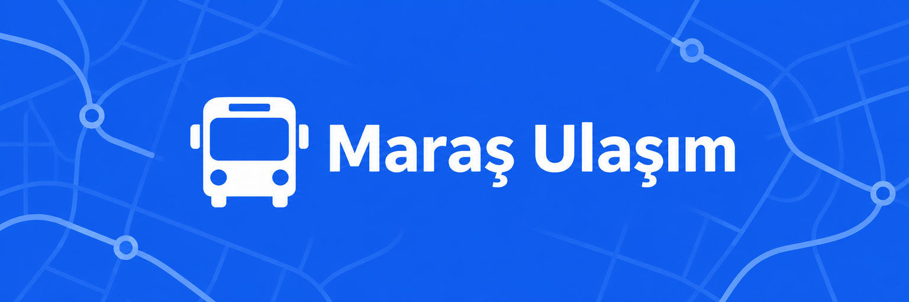
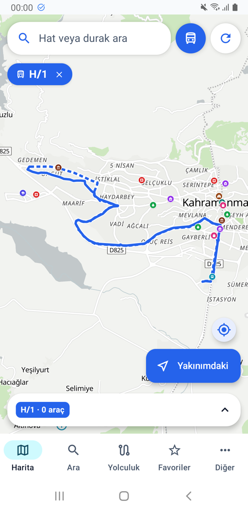
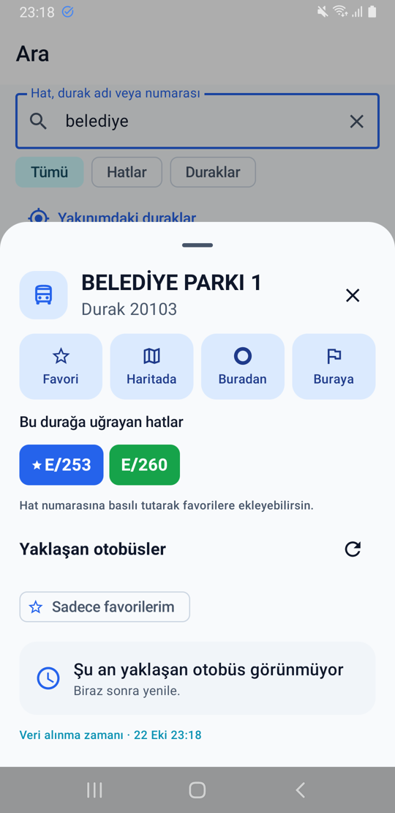
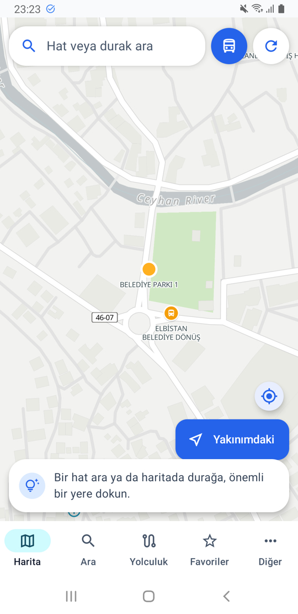
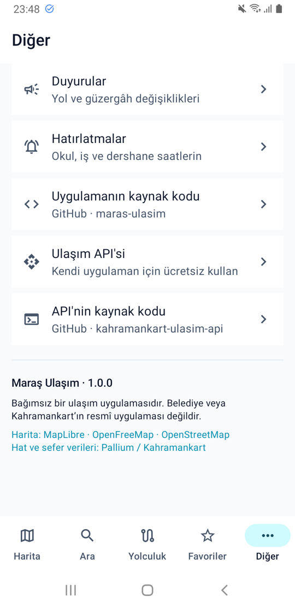

<p align="center">
  
</p>

<h1 align="center">Maraş Ulaşım</h1>

<p align="center">
  Kahramanmaraş otobüsleri için Android uygulaması.<br>
  Hatları haritada canlı izle, durağa yaklaşan otobüsleri gör, favorilerini kaydet.
</p>

<p align="center">
  
  
  <a href="LICENSE"></a>
</p>

<p align="center">
  <a href="https://github.com/uzaylikafasi/maras-ulasim/releases/tag/v1.0.0">
    
  </a>
  <br>
  <a href="https://mithrixa.com/ulasim-api/download">Yedek indirme bağlantısı</a>
</p>

> **Bağımsız bir uygulamadır. Belediye veya Kahramankart'ın resmî uygulaması değildir.** Veriler kaynağın verdiği gibidir; varış süreleri tahmindir.

## Ekran görüntüleri

<table>
  <tr>
    <td align="center"><a href="docs/ekran/harita.png"></a></td>
    <td align="center"><a href="docs/ekran/durak.png"></a></td>
    <td align="center"><a href="docs/ekran/duraklar.png"></a></td>
    <td align="center"><a href="docs/ekran/diger.png"></a></td>
  </tr>
  <tr>
    <td align="center">H/1 hattı haritada</td>
    <td align="center">Durak menüsü</td>
    <td align="center">Haritada duraklar</td>
    <td align="center">Diğer ekranı</td>
  </tr>
</table>

## Özellikler

- **Canlı harita:** Hatları gidiş ve dönüş yönleriyle aynı anda 4 hatta kadar izle. Otobüs işaretleri aracın yönünü gösterir.
- **Durak bilgileri:** Durağa dokunarak yaklaşan otobüsleri gör. “Sadece favorilerim” filtresiyle yalnızca favori hatlarını göster.
- **Yakındaki duraklar:** Yakınındaki durakları ve bu duraklardan geçen hatları bul.
- **Favoriler:** Hat, durak ve plaka kaydet; ana ekran widget'ını kullan.
- **Yolculuk bilgileri:** İki durak arası yolculuk önerilerine, sefer saatlerine ve duyurulara bak.
- **Hatırlatmalar:** Okul ve iş saatleri için hatırlatmalar kullan.
- **Açık kaynak harita:** MapLibre, OpenFreeMap ve OpenStreetMap.

## Kurulum

1. [1.0.0 sürümünün APK dosyasını indir](https://github.com/uzaylikafasi/maras-ulasim/releases/tag/v1.0.0). Gerekirse [yedek bağlantıyı](https://mithrixa.com/ulasim-api/download) kullan.
2. İndirdiğin APK dosyasını aç.
3. Android istediğinde, dosyayı açtığın uygulamaya “bilinmeyen kaynaklardan yükleme” izni ver ve kurulumu tamamla.

Play Store dışından kurulum sırasında Play Protect uyarı gösterebilir. Android 8.0 ve üzeri gerekir.

## Veri kaynağı

Uygulama verileri [Maraş Ulaşım API](https://mithrixa.com/ulasim-api/docs)'sinden alır. API'nin kaynak kodu: [kahramankart-ulasim-api](https://github.com/uzaylikafasi/kahramankart-ulasim-api).

## Geliştirme ve derleme

Kullanılan teknolojiler: Kotlin, Jetpack Compose, MapLibre Native, OkHttp ve DataStore.

```sh
./gradlew :app:assembleDebug        # geliştirme sürümü
./gradlew :app:testDebugUnitTest    # birim testleri
```

Yayın imzası depoda yoktur. `~/.config/maras-ulasim-imza/signing.properties` dosyası (veya `MARAS_SIGNING` ortam değişkeni) varsa `assembleRelease` imzalı APK üretir. Raspberry Pi gibi ARM64 Linux makinelerde `./build-pi.sh` kullanılabilir.

## Lisans

Bu proje [MIT lisansı](LICENSE) ile sunulmaktadır. Üçüncü taraf lisansları için [THIRD_PARTY_NOTICES.txt](THIRD_PARTY_NOTICES.txt) dosyasına bakabilirsin.
