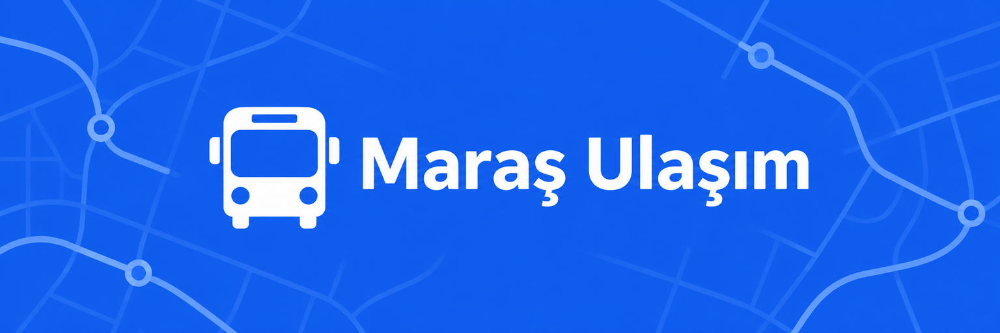
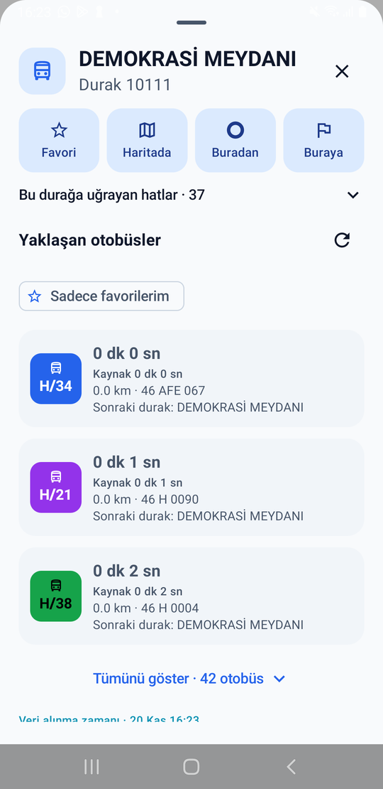
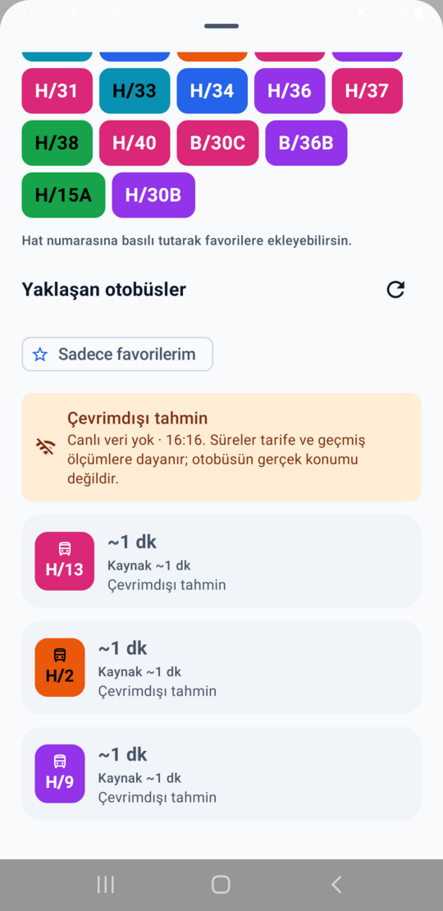
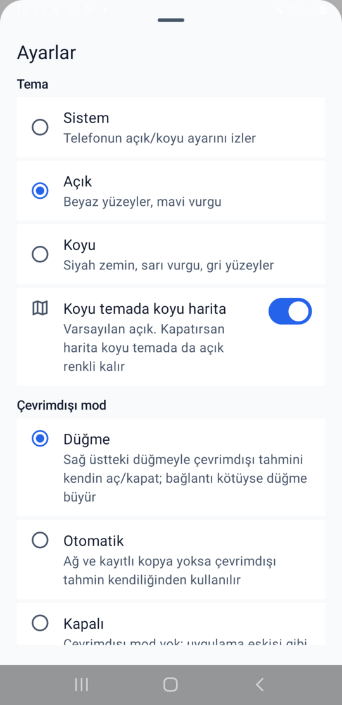
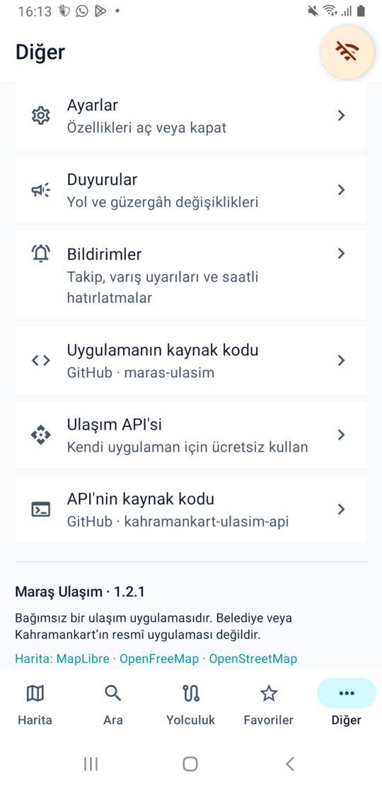

<p align="center">
  
</p>

<h1 align="center">Maraş Ulaşım</h1>

<p align="center">
  Kahramanmaraş otobüslerini haritada canlı izle, durağa yaklaşan otobüsleri gör.<br>
  İnternet zayıfken çevrimdışı tahminle devam et.
</p>

<p align="center">
  <a href="https://github.com/uzaylikafasi/maras-ulasim/releases/latest">
    
  </a>
</p>

<p align="center">
  
  
  <a href="LICENSE"></a>
</p>

> [!IMPORTANT]
> Bağımsız bir uygulamadır; belediye veya Kahramankart'ın resmî uygulaması değildir. Varış süreleri kaynağın tahminidir.

<table>
  <tr>
    <td align="center"></td>
    <td align="center"></td>
    <td align="center"></td>
    <td align="center"></td>
    <td align="center"></td>
  </tr>
  <tr>
    <td align="center">Canlı otobüsler</td>
    <td align="center">Durak menüsü</td>
    <td align="center">Çevrimdışı tahmin</td>
    <td align="center">Ayarlar</td>
    <td align="center">Diğer</td>
  </tr>
</table>

## Neler yapabilirsin?

- **Canlı harita:** En çok 4 hattı gidiş ve dönüş yönleriyle aynı anda izle.
- **Durak bilgisi:** Durağa dokun, en yakın 3 otobüsü gör; kalabalık duraklarda gerisi "Tümünü göster" ile açılır. Uğrayan hatlar katlanır.
- **Yakındaki duraklar:** Konumuna yakın durakları ve geçen hatları bul.
- **Favoriler:** Hat, durak ve plaka kaydet; ana ekrana widget ekle.
- **Bildirim ve takip:** Otobüs belirli dakikaya gelince uyarı al; okul ve iş hatırlatmaları kur.
- **Çevrimdışı mod:** Bağlantı kötüyken süreler tarifeden ve geçmiş ölçümlerden tahmin edilir. Tahmin kartı bunu açıkça belirtir.
- **Koyu tema:** Sistem, açık veya koyu; harita da koyulaşabilir.
- **Güncelleme:** Yeni sürümleri günde bir kontrol eder.

<details>
<summary>Daha fazla ayrıntı</summary>

- **Çevrimdışı mod:** Model küçük bir dosyadır ve günde bir kez kendiliğinden güncellenir. Ayarlar > Çevrimdışı mod: Düğme (varsayılan), Otomatik, Kapalı. Tahmin otobüsün gerçek konumu değildir.
- **Koyu tema:** Ayarlar > Tema. “Koyu temada koyu harita” kapatılırsa harita açık kalır.
- **Daha hafif harita:** Duraklar yalnız yakından görünür; şehir ölçeğinde gizlenir. Konum yaklaşık 30 saniyede bir sorgulanır.
- **Bildirimler:** Bildirimler > Otobüs ekle ile durak ve otobüs seç. Arka planda en çok iki saat takip edilir. Süresi bilinmeyen otobüs için uyarı verilmez.
- **Süre payları:** Durak ve ışık payı deneyseldir, isteğe bağlıdır. [Ölçüm notları](docs/eta-arastirma.md).
- **Harita:** MapLibre, OpenFreeMap ve OpenStreetMap.

</details>

## Kurulum

1. [Son sürümün APK dosyasını indir](https://github.com/uzaylikafasi/maras-ulasim/releases/latest).
2. APK dosyasını aç.
3. Android sorarsa, dosyayı açtığın uygulamaya “bilinmeyen kaynaklardan yükleme” izni ver ve kurulumu bitir.

> [!NOTE]
> Play Store dışından kurulumda Play Protect uyarı gösterebilir. Android 8.0 ve üzeri gerekir.

## Veri kaynağı

Veriler [Maraş Ulaşım API](https://mithrixa.com/ulasim-api/docs)'sinden gelir. API'nin kaynak kodu: [kahramankart-ulasim-api](https://github.com/uzaylikafasi/kahramankart-ulasim-api).

## Geliştirme

Kotlin, Jetpack Compose, MapLibre Native, OkHttp ve DataStore kullanılır.

```sh
./gradlew :app:assembleDebug        # geliştirme sürümü
./gradlew :app:testDebugUnitTest    # birim testleri
```

<details>
<summary>İmzalı sürüm ve Raspberry Pi derlemesi</summary>

Yayın imzası depoda yoktur. `~/.config/maras-ulasim-imza/signing.properties` dosyası (veya `MARAS_SIGNING` ortam değişkeni) varsa `assembleRelease` imzalı APK üretir. Raspberry Pi gibi ARM64 Linux makinelerde `./build-pi.sh` kullanılabilir.

</details>

## Lisans

[MIT lisansı](LICENSE). Üçüncü taraf lisansları: [THIRD_PARTY_NOTICES.txt](THIRD_PARTY_NOTICES.txt).
