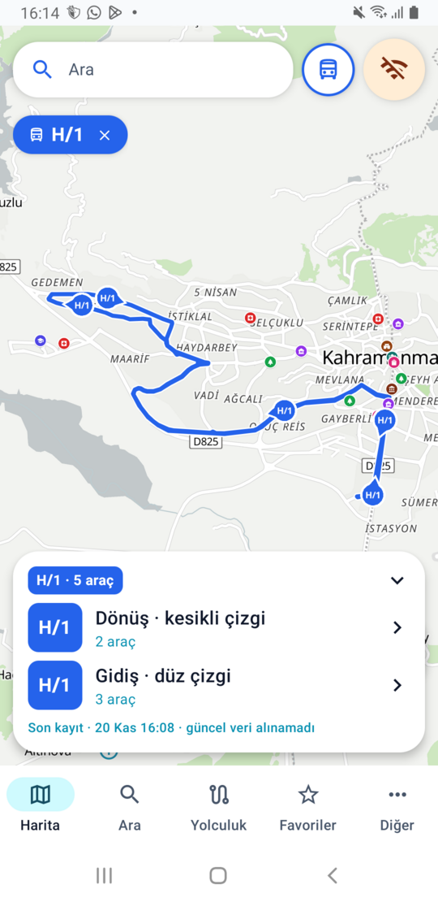
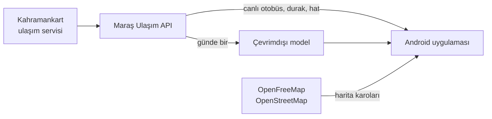

<p align="center">
  
</p>

<h1 align="center">Maraş Ulaşım</h1>

<p align="center">
  Kahramanmaraş otobüslerini haritada canlı izle, durağa yaklaşan otobüsleri gör.<br>
  İnternet zayıfken çevrimdışı tahminle devam et.
</p>

<p align="center">
  <a href="https://github.com/uzaylikafasi/maras-ulasim/releases/latest">
    
  </a>
</p>

<p align="center">
  
  
  <a href="LICENSE"></a>
</p>

> [!IMPORTANT]
> Bağımsız bir uygulamadır; belediye veya Kahramankart'ın resmî uygulaması değildir. Varış süreleri kaynağın tahminidir.

<table>
  <tr>
    <td align="center"></td>
    <td align="center"></td>
    <td align="center"></td>
    <td align="center"></td>
    <td align="center"></td>
  </tr>
  <tr>
    <td align="center">Canlı otobüsler</td>
    <td align="center">Durak menüsü</td>
    <td align="center">Çevrimdışı tahmin</td>
    <td align="center">Ayarlar</td>
    <td align="center">Diğer</td>
  </tr>
</table>

<p align="center">
  <a href="#neden-yaptım">Neden yaptım?</a> ·
  <a href="#neler-yapabilirsin">Özellikler</a> ·
  <a href="#kurulum">Kurulum</a> ·
  <a href="#nasıl-kullanılır">Kullanım</a> ·
  <a href="#nasıl-çalışır">Nasıl çalışır?</a> ·
  <a href="#kullanılan-teknolojiler">Teknolojiler</a> ·
  <a href="#geliştirme">Geliştirme</a>
</p>

## Neden yaptım?

Kahramanmaraş'ta otobüs saatini öğrenmek için kullanılan mevcut uygulama bana yeterince kararlı gelmiyordu. Durakta beklerken istediğim şey basitti: otobüs nerede, kaç dakikaya gelir? Maraş Ulaşım bu soruya hızlı cevap vermek için yazıldı. Açık kaynak harita kullanıyor, sık kullandığın hatları öne çıkarıyor ve internet zayıfken bile tahmin göstermeye devam ediyor.

## Neler yapabilirsin?

- **Canlı harita:** En çok 4 hattı gidiş ve dönüş yönleriyle aynı anda izle.
- **Durak bilgisi:** Durağa dokun, en yakın 3 otobüsü gör; kalabalık duraklarda gerisi "Tümünü göster" ile açılır. Uğrayan hatlar katlanır.
- **Yakındaki duraklar:** Konumuna yakın durakları ve geçen hatları bul.
- **Favoriler:** Hat, durak ve plaka kaydet; ana ekrana widget ekle.
- **Bildirim ve takip:** Otobüs belirli dakikaya gelince uyarı al; okul ve iş hatırlatmaları kur.
- **Çevrimdışı mod:** Bağlantı kötüyken süreler tarifeden ve geçmiş ölçümlerden tahmin edilir. Tahmin kartı bunu açıkça belirtir.
- **Koyu tema:** Sistem, açık veya koyu; harita da koyulaşabilir.
- **Güncelleme:** Yeni sürümleri günde bir kontrol eder.

<details>
<summary>Daha fazla ayrıntı</summary>

- **Çevrimdışı mod:** Model küçük bir dosyadır ve günde bir kez kendiliğinden güncellenir. Ayarlar > Çevrimdışı mod: Düğme (varsayılan), Otomatik, Kapalı. Tahmin otobüsün gerçek konumu değildir.
- **Koyu tema:** Ayarlar > Tema. “Koyu temada koyu harita” kapatılırsa harita açık kalır.
- **Daha hafif harita:** Duraklar yalnız yakından görünür; şehir ölçeğinde gizlenir. Konum yaklaşık 30 saniyede bir sorgulanır.
- **Bildirimler:** Bildirimler > Otobüs ekle ile durak ve otobüs seç. Arka planda en çok iki saat takip edilir. Süresi bilinmeyen otobüs için uyarı verilmez.
- **Süre payları:** Durak ve ışık payı deneyseldir, isteğe bağlıdır. [Ölçüm notları](docs/eta-arastirma.md).

</details>

## Kurulum

1. [Son sürümün sayfasını aç](https://github.com/uzaylikafasi/maras-ulasim/releases/latest) ve telefonuna uyan APK'yı indir:

   | Telefonun | İndirilecek dosya |
   |---|---|
   | Android 8.0 ve üzeri (çoğu telefon) | `maras-ulasim-vX.Y.Z-arm64.apk`; açılmazsa `maras-ulasim-vX.Y.Z.apk` |
   | **Android 6.0 ve 7.x (eski telefon, ör. Galaxy J7)** | **`maras-ulasim-vX.Y.Z-android6.apk`** |

2. APK dosyasını aç.
3. Android sorarsa, dosyayı açtığın uygulamaya “bilinmeyen kaynaklardan yükleme” izni ver ve kurulumu bitir.

> [!NOTE]
> Android 6 APK'sı ayrı bir dosyadır; normal APK Android 8.0 ister ve eski telefona kurulmaz. Android 8 ve üzerinde `-android6` dosyasını kullanma. Play Store dışından kurulumda Play Protect uyarı gösterebilir. Android 6 APK'sı henüz gerçek bir Android 6 cihazında denenmedi.

## Nasıl kullanılır?

Sabah okula giden H/1 otobüsünü takip etmek için:

1. **Ara** sekmesine `H/1` yaz ve hattı seç. Güzergâh ve şu an yoldaki otobüsler haritada belirir.
2. Bineceğin durağa dokun. Durağa yaklaşan otobüsler ve kalan süreleri listelenir.
3. Haritanın üstündeki hat numarasına basılı tutarak hattı favorilere ekle. Favoriler ana ekran widget'ında da görünür.
4. Evden çıkmadan önce **Bildirimler > Otobüs ekle** ile durağı ve otobüsü seç, kaç dakika kala uyarılmak istediğini belirle. Otobüs o süreye gelince bildirim gelir.
5. Bağlantı koparsa durak kartı çevrimdışı tahmine geçer ve bunu açıkça yazar.

## Nasıl çalışır?

Uygulama veriyi doğrudan belediye sistemine değil, aradaki [Maraş Ulaşım API](https://mithrixa.com/ulasim-api/docs)'sine sorar ([kaynak kodu](https://github.com/uzaylikafasi/kahramankart-ulasim-api)). Bu API, Kahramankart ulaşım servisindeki hat, durak, canlı araç ve sefer saati verilerini tek, düzenli bir biçime çevirir. Uygulama haritayı MapLibre ile OpenFreeMap karolarından çizer, canlı otobüsleri yaklaşık 15 saniyede bir yeniler (bağlantı kötüyse aralık uzar).

İnternet zayıfken devreye çevrimdışı model girer: sefer saatleri ve geçmiş ölçümlerden üretilen küçük bir dosya (yaklaşık 400 KB). Uygulamanın içinde bir kopyası gelir, günde bir kez arka planda güncellenir. Ayrıntılar: [model şeması](docs/offline-model-sema.md), [varış süresi ölçümleri](docs/eta-arastirma.md).



## Kullanılan teknolojiler

| Parça | Ne kullanıldı | Neden |
|---|---|---|
| Dil ve arayüz | Kotlin, Jetpack Compose, Material 3 | Widget, bildirim ve arka plan işleri Android'e özgü; yerel uygulama bunları en sorunsuz yapıyor. |
| Harita | MapLibre Native, OpenFreeMap, OpenStreetMap | Açık kaynak ve ücretsiz; anahtar ya da kota derdi yok. Harita kodu küçük bir katmanda tutuldu, kütüphane değişirse uygulamanın geri kalanı etkilenmesin diye. |
| Ağ | OkHttp | Kısa zaman aşımlarıyla zayıf bağlantıda ekranın donmasını önlemek için; büyük model dosyası ayrı, uzun süreli istemciyle iner. |
| Yerel veri | DataStore | Favoriler, ayarlar ve hatırlatmalar küçük veriler; veritabanı gerektirmiyor. |
| Arka plan | WorkManager | Çevrimdışı modeli ve güncellemeleri pili yormadan, Android'in uygun gördüğü zamanda indirmek için. |
| Derleme | Gradle (Kotlin DSL) | Android'in standart derleme aracı. ARM64 Linux'ta (Raspberry Pi) da derlenebiliyor. |

<details>
<summary>Proje yapısı</summary>

```text
app/src/main/java/com/uzaylikafasi/marasulasim/
  data/      API istemcisi, modeller, çevrimdışı model, yerel kayıt
  ui/        Compose ekranları, harita, görünüm modeli
  *.kt       bildirimler, hatırlatmalar, widget, güncelleme denetimi
app/src/test/  birim testleri
docs/          ölçüm notları, model şeması, ekran görüntüleri
surumler/      Raspberry Pi'de derlenmiş APK'lar
```

</details>

## Geliştirme

```sh
./gradlew :app:assembleDebug        # geliştirme sürümü
./gradlew :app:testDebugUnitTest    # birim testleri
./gradlew :app:assembleRelease -Peski=true   # Android 6.0+ için ayrı APK (minSdk 23)
```

<details>
<summary>İmzalı sürüm ve Raspberry Pi derlemesi</summary>

Yayın imzası depoda yoktur. `~/.config/maras-ulasim-imza/signing.properties` dosyası (veya `MARAS_SIGNING` ortam değişkeni) varsa `assembleRelease` imzalı APK üretir. Raspberry Pi gibi ARM64 Linux makinelerde `./build-pi.sh` kullanılabilir. `-Peski=true` ile derlenen APK `maras-ulasim-vX.Y.Z-android6.apk` adıyla yayına eklenir; uygulama kendini güncellerken kendi türünün dosyasını seçer.

</details>

## Katkı ve geri bildirim

Hata ya da öneri için [Issues](https://github.com/uzaylikafasi/maras-ulasim/issues) sayfasından kayıt açabilirsin. Mümkünse ekran görüntüsü, hat ve durak adını ekle.

## Lisans

[MIT lisansı](LICENSE). Üçüncü taraf lisansları: [THIRD_PARTY_NOTICES.txt](THIRD_PARTY_NOTICES.txt).
